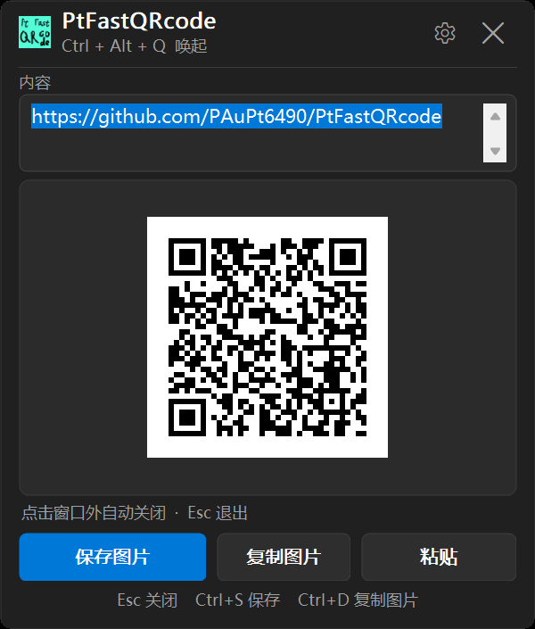
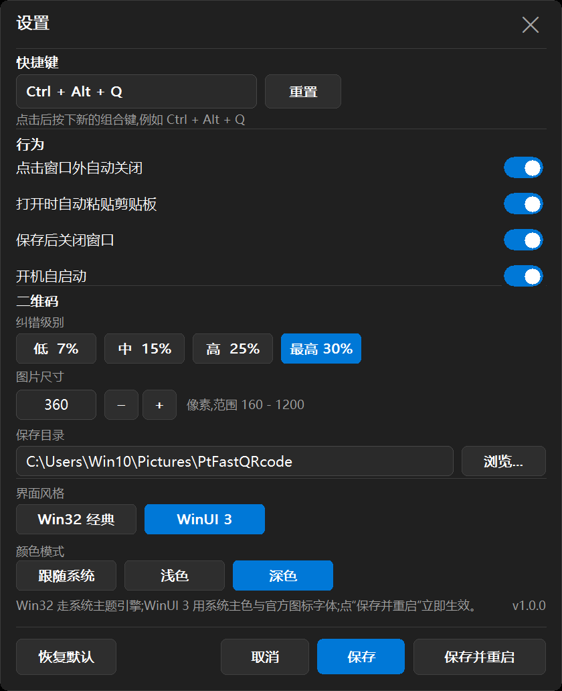
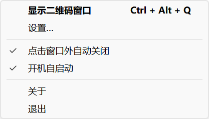

# PtFastQRcode — Windows 快捷二维码小工具

按下全局快捷键唤起一个小窗口,粘贴内容即刻生成二维码:可以直接存成 PNG,也可以复制到剪贴板。
纯 Win32 C++ 编写,**单文件 EXE(x64 约 134 KB / x86 约 116 KB)**,不链接 C 运行库、
不依赖 GDI+,只调用系统 DLL,无需安装任何运行库;窗口关闭即销毁,内存回到托盘基线。
最低支持 **Windows 7 SP1**(x86 版同时覆盖 32/64 位系统)。





## 功能一览

| 功能 | 说明 |
| --- | --- |
| 全局快捷键 | 默认 `Ctrl + Alt + Q`,可在设置里重新捕获 |
| 唤起即粘贴 | 打开窗口时自动读取剪贴板文本并即时生成二维码 |
| 实时预览 | 编辑内容即时刷新,内容过长时给出提示 |
| 保存图片 | `保存图片` / `Ctrl + S`,PNG 尺寸可设(160–1200 px) |
| 复制图片 | `复制图片` / `Ctrl + D`,同时写入 CF_DIB 与 CF_BITMAP |
| 点击外部关闭 | 可开关;关闭后 `Esc` 直接退出 |
| 窗口可缩放 | 拖动边缘/角自由缩放,二维码随窗口放大,尺寸会被记住 |
| 托盘图标 | 左键显示窗口,右键菜单:显示/设置/失焦关闭/开机自启/关于/退出 |
| 设置界面 | 快捷键、开机自启、行为开关、纠错级别、图片尺寸、保存目录、界面风格(Win32 经典 / WinUI 3)、颜色模式(跟随系统 / 浅色 / 深色);`保存` 与 `保存并重启` |
| 单实例 | 重复启动只会唤出已运行的窗口 |
| 开机自启 | 写入 `HKCU\...\CurrentVersion\Run`,可随时关闭 |

默认保存目录:`图片\PtFastQRcode`(首次保存时自动创建,之后记住上次目录)。

## 两种界面风格 × 三种颜色模式

风格与明暗可独立选择,共 4 种组合:

| 风格 | 明暗 | 实际绘制方式(全部为官方 Windows 接口) |
| --- | --- | --- |
| Win32 经典 | 浅色 / 深色 | `UxTheme` 主题引擎绘制按钮与复选框、系统色板与系统度量;深色改用 Windows 深色界面色 |
| WinUI 3 | 浅色 / 深色 | 系统主色(`GetSysColor(COLOR_HIGHLIGHT)`)+ `Segoe Fluent Icons` 官方图标字体;Fluent 2 层级配色,8 px 圆角由窗口区域裁剪 |

**颜色模式**:`跟随系统` 读取系统「应用浅色/深色」偏好,并在系统切换时自动跟随;也可强制浅色或深色。

> 说明:真正加载 **WinUI 3 XAML** 需要 Windows App SDK 运行时(自包含发布也是一堆 DLL),
> 无法塞进"单文件、免安装、无运行库"的 EXE。因此这里的两种风格是用官方绘制与外观接口
> (UxTheme / 系统主色 / 系统图标字体)实现的等价外观,而不是在 EXE 里内置 XAML 运行时。
> 窗口圆角由程序自己裁剪窗口区域实现,不依赖 DWM,因此在 Windows 10 / 11 上表现一致;
> 代价是圆角边缘是硬裁剪、没有 DWM 那种抗锯齿过渡。

## 使用

1. 双击 `dist\PtFastQRcode.exe`,首次运行会弹出窗口。
2. 按 `Ctrl + Alt + Q` 随时唤起;窗口出现在鼠标附近。
3. 复制任意文本(网址、命令、口令…),再按快捷键:内容自动粘贴并生成二维码。
4. `Ctrl + S` 保存 PNG,`Ctrl + D` 复制图片,`Esc` 关闭。
5. 托盘图标右键进入「设置…」,可改快捷键、开机自启、纠错级别、尺寸、目录、外观。
6. 不想要"点外面就关",在设置或托盘菜单里关掉「点击窗口外自动关闭」。
7. 改了外观(风格/浅色深色)想立刻看到效果,点底部的**「保存并重启」**:程序会自动退出并由新进程接替,
   设置立即可见;若换了快捷键,重启后也直接用新组合键。

> 提示:Windows 默认把新程序的托盘图标放进**溢出区**(任务栏的 `^` 里)。把它拖到任务栏可见区域,
> 或在「设置 → 个性化 → 任务栏」里打开「显示所有系统托盘图标」,之后就能直接左键唤起、右键出菜单。



## 构建

本机已具备 MSVC Build Tools 与 Windows SDK 10.0.26100,不需要 NuGet、CMake 或任何第三方库:

```powershell
powershell -ExecutionPolicy Bypass -File build.ps1          # 增量构建
powershell -ExecutionPolicy Bypass -File build.ps1 -Clean   # 清理后重编
```

产物:

| 架构 | 文件 | 覆盖 |
| --- | --- | --- |
| x64 | `dist\PtFastQRcode.exe` | Win7 SP1 x64 及以上 |
| x86 | `dist\PtFastQRcode-x86.exe` | **Win7 SP1 起,32/64 位通吃**(64 位经 WOW64) |

```powershell
powershell -File build.ps1 -Arch x86     # 32 位
powershell -File build.ps1 -Arch x64     # 64 位(默认)
```

两种架构都设 `_WIN32_WINNT=0x0601`:导入表里没有任何 Win8+/Win10+ 的函数,
在 Win7 上不会出现"找不到入口点"而启动失败。

### 自检模式

```powershell
PtFastQRcode.exe --selftest C:\temp\check.png   # 无界面:编码固定内容并写出 PNG
```

旁边会生成 `check.png.txt`,记录符号尺寸、保存是否成功与文件字节数。
在没有桌面自动化的机器(如虚拟机)上验证"生成 + WIC 编码"是否正常时很有用。

### 体积与内存是怎么压下来的

| 措施 | 效果 |
| --- | --- |
| 图标只保留 16/20/24/32/48 + 256(调色板 PNG) | 64 KB → 27 KB |
| `/NODEFAULTLIB` + 自写入口(`crt_stub.cpp`/`crt_mem.c`) | 去掉静态 CRT,**−106 KB** |
| 去掉 GDI+ 依赖,圆角改 GDI `RoundRect`,PNG 改 WIC 编码 | 少链接一个组件,`gdiplus.dll` 不再加载 |
| 字体改为首次开窗时创建;`comdlg32.dll` 首次保存时才加载 | 托盘驻留态少 4 个字体、少一个 DLL |
| 主窗口按脏区绘制(状态文字变化不再重画二维码) | 局部刷新成本≈0 |
| 窗口隐藏即销毁(不再只是 `SW_HIDE`) | 关窗后回到托盘基线 |
| 保存对话框放到**子进程**里开 | Shell 扩展不会常驻,省下约 9–13 MB |
| COM 延迟到真正需要时才初始化 | 托盘态不初始化 ole32 |

结果(本机 150% DPI,Windows 11):

| 指标 | 优化前 | 优化后 |
| --- | --- | --- |
| EXE 体积 | 291.5 KB | **128 KB** |
| x86 构建体积 | — | **116 KB** |
| 私用内存(仅托盘) | 1.87 MB | **1.48 MB** |
| 私用内存(窗口打开) | 2.55 MB | **2.24 MB** |
| 工作集(窗口打开) | 20 MB | **17.8 MB** |
| 保存后回落(工作集) | 65 MB(不回落) | **1.6 MB** |
| 整窗重绘 | 约 25 ms | **约 1.4–6.5 ms** |
| 启动到窗口可见 | — | 约 190 ms(5 次平均) |

> 说明:去掉 GDI+ 后,按钮/卡片的圆角由 GDI 绘制,边缘不再抗锯齿(1 px 阶梯);
> 窗口本身的圆角本来就由区域裁剪实现,观感一致。

### 保存对话框为什么另起进程

`GetSaveFileNameW` 会把资源管理器的 Shell 扩展加载进调用它的进程,COM 只要还持有引用
就不会卸载:实测对话框打开时私有内存 46 MB,关掉后仍停在 15 MB。放进子进程后,主进程
全程不加载 `comdlg32`,对话框关掉时那部分内存随子进程一起消失,主进程回落到 1.6 MB。

子进程就是本程序的 `--pick-save` 模式:弹出同样的系统对话框,把选中的路径写回临时文件后退出;
主进程用 `MsgWaitForMultipleObjects` 等待并继续处理消息,界面不会卡住。

## 目录结构

```
PtFastQRcode/
├─ build.ps1                 构建脚本(rc → cl → link)
├─ dist/PtFastQRcode.exe       交付产物(单文件)
├─ assets/app.ico            由 PtFastQRcode.png 生成的多尺寸图标
├─ PtFastQRcode.png          原始图标素材
├─ src/
│  ├─ qr/qrcode.{h,cpp}      QR 编码器(Model 2,版本 1–40,L/M/Q/H,自动掩码)
│  ├─ app/app.h              公共声明(设置、主题、窗口、绘图)
│  ├─ app/core.cpp           设置持久化、主题、系统色/主色、UxTheme、窗口圆角裁剪、字体
│  ├─ app/ui.cpp             按钮/开关/分段控件绘制(含 UxTheme 原生路径)
│  ├─ app/qrimage.cpp        二维码 DIB 渲染、WIC 编码 PNG、剪贴板
│  ├─ app/text_util.cpp      取代 CRT 的字符串/路径工具
│  ├─ app/crt_stub.cpp       自写入口、堆分配、STL 终止钩子(无 CRT)
│  ├─ app/crt_mem.c          memcpy/memset/宽字符原语(无 CRT)
│  ├─ app/popup.cpp          主悬浮窗(自适应布局、失焦关闭、保存流程)
│  ├─ app/settings_win.cpp   设置窗口(快捷键捕获、开机自启、外观)
│  ├─ app/main.cpp           托盘、全局热键、单实例、消息循环
│  └─ res/                   图标、清单、版本信息
├─ docs/                     截图
└─ tools/                    验证脚本(C++/C# 编码器比对、截图、端到端测试)
```

## 验证记录

二维码编码器(自带实现,未引入第三方库):

| 检查项 | 结果 |
| --- | --- |
| 与 Nayuki 参考实现逐模块比对 | 107 个符号,0 处不一致 |
| 与 python-qrcode 比对(8 种掩码) | 824 个符号,0 处不一致 |
| zxing-cpp 扫码回读 | 103 个符号全部解出原文 |
| C++ 实现 vs 已验证的 C# 实现 | 全部用例逐字节一致 |

端到端(真实键鼠事件驱动):

| 检查项 | 结果 |
| --- | --- |
| `Ctrl+Alt+Q` 唤起(启动时隐藏) | 使用前不可见 → 使用后可见 |
| 唤起自动粘贴剪贴板 | 编辑框内容与剪贴板一致 |
| `Ctrl+S` → 保存对话框 → 回车 | 生成 PNG,并经 zxing 解回原 URL |
| 点击窗口外 | 窗口隐藏 |
| 托盘右键菜单 | 正确弹出,含快捷键提示与勾选状态 |
| 开机自启 | `HKCU\...\Run` 写入/删除均正确 |
| 设置持久化 | `HKCU\Software\PtFastQRcode` 读写正常,重启生效 |
| 重复启动 | 仍为单进程,原实例被唤出 |
| 缩放窗口 | 二维码同步放大,底部按钮/状态栏保持贴底 |
| 资源占用 | 私有内存:仅托盘 1.54 MB,打开窗口约 2.1 MB(反复开关不增长);调用系统保存对话框后系统会加载资源管理器扩展,私有内存升至约 13 MB(Windows 通用对话框行为,非本程序泄漏) |
| 无运行库依赖 | 导入表仅 kernel32/user32/gdi32/shell32/ole32/comctl32/advapi32/uxtheme,无 CRT、无 GDI+ |

## Windows 7 实测

在一台 Windows 7 RTM 32 位虚拟机(VirtualBox)上验证:

| 检查项 | 结果 |
| --- | --- |
| 32 位 EXE 启动 | ✅ 原生运行,进程正常驻留托盘 |
| 界面风格 | ✅ 自动判定为非 Win10,默认用 Win32 经典风格 |
| 剪贴板自动粘贴 | ✅ |
| 二维码生成 | ✅ 从虚拟机截图解码得回原文 |
| 托盘图标 | ✅ |
| 保存 PNG(WIC) | ✅ 文件写出、alpha 不透明、扫码解回原文 |
| 保存对话框 | ✅ 子进程正常弹出“另存为”,类型/预填文件名正确 |

> Win7 上对话框默认打开"上次用过的文件夹"(系统 MRU 行为),而不是设置里的保存目录;
> 这是 `GetSaveFileNameW` 的既定行为,保存位置始终以用户最后选择为准。

## 已知限制

- 最低支持 Windows 7 SP1;XP 不在支持范围内(需要 XP 专用工具集与另一套 API 降级)。
- 采用系统级 DPI 感知:在不同缩放比例的显示器之间拖动不会自动重排,但窗口可手动缩放。
- 托盘图标沿用素材原图的整体图案,16 px 下细节辨识度有限。
- 设置保存在注册表 `HKCU\Software\PtFastQRcode`,不做多用户隔离之外的处理。
