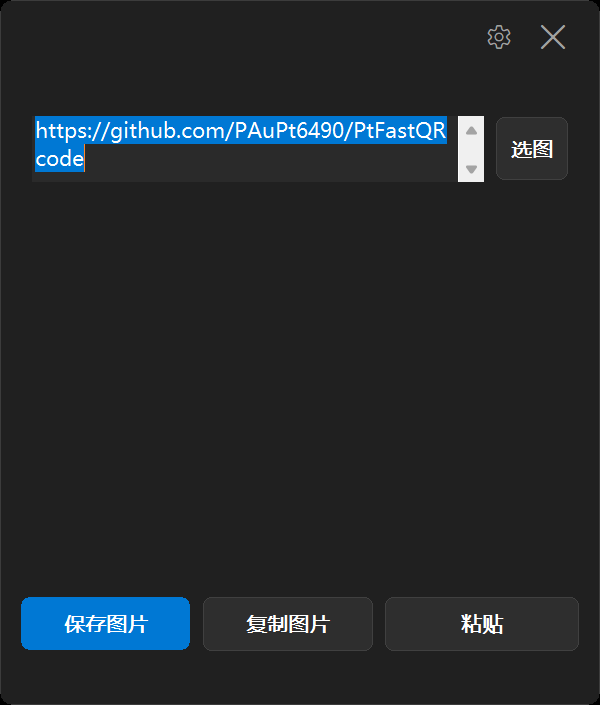
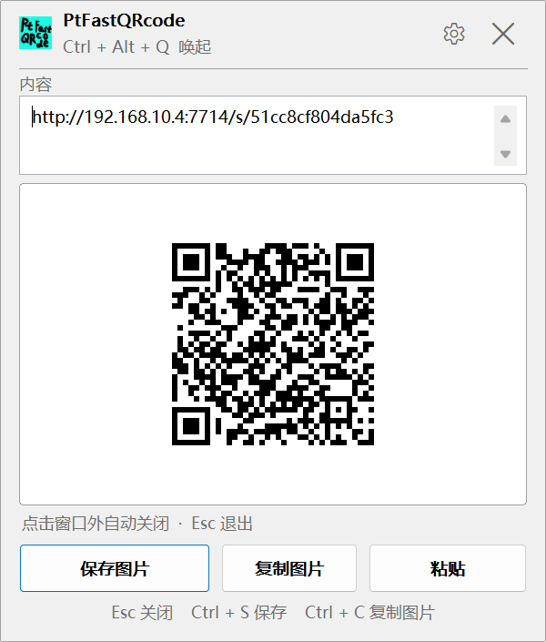
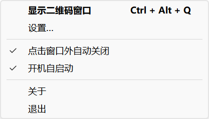
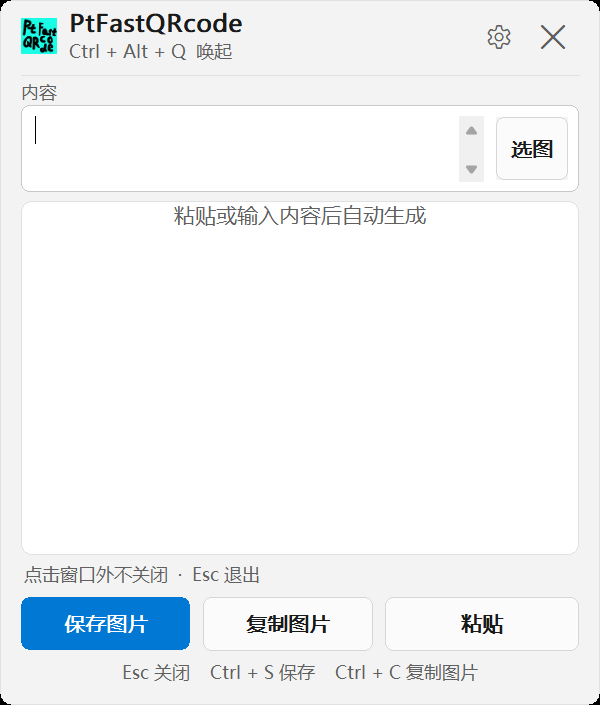
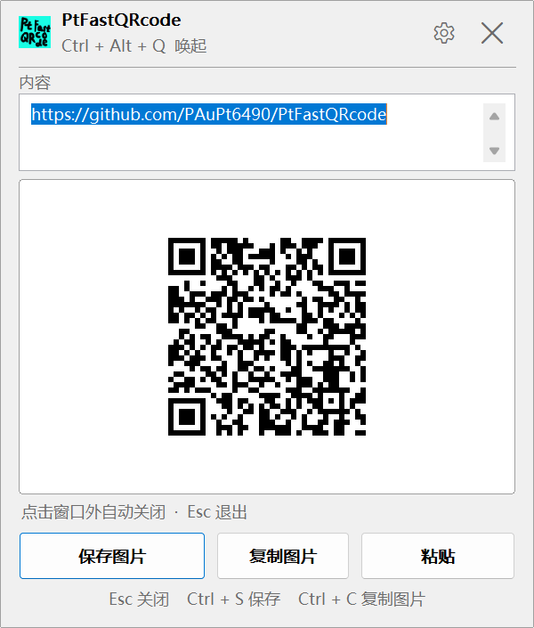
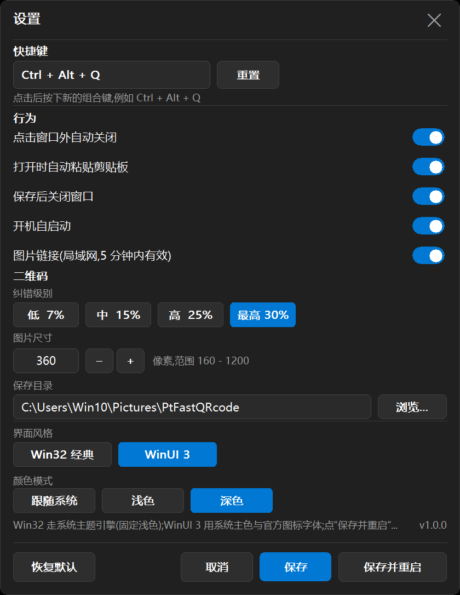

# PtFastQRcode

**按一下快捷键，粘上内容，二维码就好了。**


一个 Windows 托盘小工具：全局热键唤起小窗，把剪贴板里的文本（或图片）变成二维码，可直接存 PNG 或复制到剪贴板。

- **单文件 EXE，不装任何运行库**：x64 约 168 KB，x86 约 144 KB
- **纯 Win32 C++**：不链接 C 运行库、不依赖 GDI+/DWM，只用系统 DLL
- **Windows 7 SP1 起**：x86 版在 32/64 位系统上都能跑
- **不驻留内存**：窗口关掉即销毁，回到托盘基线约 1.5 MB

<p align="center">
  
  
</p>

---

## 功能

| | |
| --- | --- |
| **全局热键** | 默认 `Ctrl + Alt + Q`，可在设置里重新捕获 |
| **唤起即粘贴** | 打开窗口就读取剪贴板文本并即时生成，边打字边刷新 |
| **保存 / 复制** | `Ctrl + S` 存 PNG（尺寸 160–1200 px 可调），`Ctrl + C` 复制到剪贴板 |
| **图片也能扫** | 粘贴图片或点「选图」挑本地文件，压缩后挂到局域网临时网页，二维码指向手机可打开的地址 |
| **贴在鼠标旁** | 窗口可自由缩放，二维码跟着放大，尺寸会被记住 |
| **三种外观** | Win32 经典（原生 UxTheme）／WinUI 3 浅色／WinUI 3 深色／跟随系统 |
| **托盘常驻** | 左键唤起，右键菜单：显示 / 设置 / 失焦关闭 / 开机自启 / 关于 / 退出 |
| **单实例** | 重复启动只会唤出已运行的窗口 |

## 开始用

1. 到 [Releases](../../releases) 下载 `PtFastQRcode.exe`（64 位）或 `PtFastQRcode-x86.exe`（32 位，Win7 也能跑），放到任意目录，双击即可。
2. 按 `Ctrl + Alt + Q` 唤起窗口。
3. 复制任意文本（网址、命令、口令……），再按快捷键 —— 内容自动填入并生成二维码。
4. `Ctrl + S` 保存，`Ctrl + C` 复制图片，`Esc` 关闭窗口。

保存目录默认是 `图片\PtFastQRcode`，首次保存时创建，之后记住上次用过的目录。

> 新程序的托盘图标通常被 Windows 塞进任务栏的 `^` 溢出区。把它拖出来，或在
> 「设置 → 个性化 → 任务栏」里勾选「显示所有系统托盘图标」，之后就能直接左键唤起。

<p align="center">
  
</p>

## 图片链接（局域网）

一张图片塞不进二维码，所以开启这个开关后，图片走的是「链接」这条路：

1. 设置里打开「图片链接(局域网)」（默认关闭），下面填「链接有效期」秒数（1–7200，默认 120）。
2. 复制一张图，按 `Ctrl + Alt + Q`；也可以直接点输入框右边的「选图」挑本地文件。
3. 程序把图片压到长边 720 px、编码成 PNG 放在内存里，起一个只监听私有网段的 HTTP 服务，
   生成随机地址 `http://192.168.x.x:端口/s/<16 位十六进制>`，把**这个地址**做成二维码。
4. 手机扫码看到网页里的图片，长按或另存即可存进相册。
5. 到了有效期，图片缓存清空、服务关闭，内存里什么都不留；再粘一张会自动重新开。

弹窗里二维码左边会显示这张图的缩略图（长边最长 256 px，只留在内存里），确认没贴错图。
有效期改完点「保存」立刻生效，不用重启。

**几个有意的取舍：**

| 决定 | 原因 |
| --- | --- |
| 页面与图片分成两个请求 | 图片以独立 PNG 返回，浏览器缓存、长按另存都正常，响应里也不用做 base64 |
| 不内嵌 base64 | 省下的只是一次局域网握手（1–3 ms），代价是体积 +33%、内存峰值 1.33× |
| 不做 keep-alive | 每次请求独立连接；keep-alive 一旦连接槽被空占，整页就打不开 |
| 图片只存在内存 | 不落盘、不写临时文件，过期或退出即消失 |
| 只接受私有网段 | 10/8、172.16/12、192.168/16、127/8 之外的连接直接断开 |
| HTTP 服务按需启停 | 没粘过图、或链接过期后，进程里连网络栈都没有 |

第一次开启时防火墙会弹窗询问，选「允许访问」；误点拒绝可到
「Windows 安全中心 → 防火墙和网络保护 → 允许应用通过防火墙」里补勾。

> 走的是明文 HTTP，同一局域网内能看到流量的人也能看到图片，只在可信网络里用。

## 外观

主题是一个值，存在 `HKCU\Software\PtFastQRcode` 的 `Theme` 下：

| 值 | 主题 | 说明 |
| --- | --- | --- |
| `0` | Win32 经典 | `UxTheme` 主题引擎绘制，系统字体、系统色板，固定浅色 |
| `1` | 跟随系统 | WinUI 3 外观，随 Windows「应用」浅色/深色实时切换 |
| `2` | WinUI 3 浅色 | 系统主色 + `Segoe Fluent Icons`，圆角由窗口区域裁剪 |
| `3` | WinUI 3 深色 | 同上，换成 Fluent 深色配色 |

| 系统 | 可选风格 | 颜色模式 |
| --- | --- | --- |
| Windows 10 1809（build 17763）及以上 | Win32 经典 + WinUI 3 | 跟随系统 / 浅色 / 深色 |
| Windows 7 / 8 / 8.1、Win10 早期版本 | 仅 Win32 经典 | 固定浅色（WinUI 3 与颜色模式置灰） |

判断依据是系统自带的 Fluent 组件（`Segoe Fluent Icons`、系统主色、深色界面色），
Win10 1809 起才有，更老的系统就不开放 WinUI 3 风格。

> 真正加载 WinUI 3 XAML 需要 Windows App SDK 运行时（自包含发布也是一堆 DLL），
> 与「单文件、免安装、无运行库」互斥。这里的两种风格是**用官方绘制与外观接口
> （UxTheme / 系统主色 / 系统图标字体）实现的等价外观**，不是内置 XAML 运行时。
> 窗口圆角由程序自己裁剪窗口区域完成，不依赖 DWM，Win10/Win11 表现一致，
> 代价是边缘为硬裁剪、没有 DWM 的抗锯齿过渡。

<p align="center">
  
  
  
</p>

## 设置项

快捷键、开机自启、失焦关闭、唤起即粘贴、保存后关闭、图片链接、链接有效期，
以及编码参数与外观：纠错级别（L/M/Q/H）、PNG 尺寸（160–1200 px）、保存目录、
界面风格、颜色模式。

改完点「保存」；如果想让外观或快捷键**立刻**生效，点「保存并重启」——
程序由新进程接替，设置即时可见。

配置都在 `HKCU\Software\PtFastQRcode`；开机自启写 `HKCU\...\CurrentVersion\Run`。

## 构建

只需要 **MSVC Build Tools + Windows SDK**，不用 CMake、不用 NuGet、没有任何第三方库：

```powershell
powershell -ExecutionPolicy Bypass -File build.ps1            # 64 位，增量构建
powershell -ExecutionPolicy Bypass -File build.ps1 -Clean     # 清理后重编
powershell -ExecutionPolicy Bypass -File build.ps1 -Arch x86  # 32 位
```

| 架构 | 产物 | 覆盖 |
| --- | --- | --- |
| x64 | `dist\PtFastQRcode.exe`（168.5 KB） | Win7 SP1 x64 及以上 |
| x86 | `dist\PtFastQRcode-x86.exe`（144.0 KB） | Win7 SP1 起，32/64 位通吃（64 位走 WOW64） |

两种架构都设 `_WIN32_WINNT=0x0601`，导入表里没有任何 Win8+/Win10+ 函数，
在 Win7 上不会因为「找不到入口点」而启动失败。

无界面自检（适合在没有桌面自动化的机器上验证编码与 PNG 写出）：

```powershell
PtFastQRcode.exe --selftest C:\temp\check.png   # 旁边会多一个 check.png.txt
```

## 怎么做到 168 KB / 1.5 MB

| 措施 | 效果 |
| --- | --- |
| 图标只保留 16/20/24/32/48 + 256（调色板 PNG） | 64 KB → 27 KB |
| `/NODEFAULTLIB` + 自写入口（`crt_stub.cpp` / `crt_mem.c`） | 去掉静态 CRT，**−106 KB** |
| 去掉 GDI+，圆角改 GDI `RoundRect`，PNG 改 WIC 编码 | 少链接一个组件，不再加载 `gdiplus.dll` |
| 字体首次开窗才建；`comdlg32.dll` 首次保存才加载 | 托盘态少 4 个字体、少一个 DLL |
| 主窗口按脏区绘制 | 状态栏文字变化不再重画二维码 |
| 窗口隐藏即销毁（不是 `SW_HIDE`） | 关窗后回到托盘基线 |
| 保存/选图对话框放到**子进程** | Shell 扩展不常驻，省下 9–13 MB |
| COM 延迟初始化 | 托盘态不初始化 `ole32` |
| HTTP 服务按需启动、过期即关 | 不粘图时进程里没有 `ws2_32` |

实测（Windows 11，150% DPI）：

| 指标 | 优化前 | 现在 |
| --- | --- | --- |
| EXE 体积 | 291.5 KB | **168.5 KB**（含图片链接服务） |
| 私用内存（仅托盘） | 1.87 MB | **1.48 MB** |
| 私用内存（窗口打开） | 2.55 MB | **2.24 MB** |
| 保存后回落（工作集） | 65 MB，不回落 | **1.6 MB** |
| 整窗重绘 | 约 25 ms | **1.4–6.5 ms** |
| 启动到窗口可见 | — | 约 190 ms（5 次平均） |

**保存对话框为什么要另起进程**：`GetSaveFileNameW` 会把资源管理器的 Shell 扩展加载进调用方进程，
COM 只要还有引用就不会卸载 —— 实测对话框打开时私有内存 46 MB，关掉后仍停在 15 MB。
放进子进程后主进程全程不加载 `comdlg32`，对话框关掉时那部分内存随子进程一起消失。
子进程就是本程序的 `--pick-save` / `--pick-image` 模式，把选中的路径写回临时文件后退出；
主进程用 `MsgWaitForMultipleObjects` 等待并继续泵消息，界面不会卡。

## 验证

二维码编码器是自己实现的（Model 2，版本 1–40，L/M/Q/H，自动选掩码），没有引入第三方库：

| 检查项 | 结果 |
| --- | --- |
| 与 Nayuki 参考实现逐模块比对 | 107 个符号，0 处不一致 |
| 与 python-qrcode 比对（8 种掩码） | 824 个符号，0 处不一致 |
| zxing-cpp 扫码回读 | 103 个符号全部解出原文 |

端到端（真实键鼠事件驱动）：

| 检查项 | 结果 |
| --- | --- |
| 热键唤起 → 自动粘贴 → 生成 | 编辑框内容与剪贴板一致，二维码可解回 |
| 保存 PNG | 文件可读，zxing 解回原内容，alpha 全 255 |
| 点击窗口外 / `Esc` | 隐藏 / 退出 |
| 托盘菜单、开机自启、单实例 | 均正确 |
| 设置持久化 | 注册表读写正常，重启生效 |
| 图片链接 | 页面 200、图片 200（720×450 RGBA）、无效地址 404、过期后 404 且服务自行关闭 |
| 链接有效期 5 秒 | t=0 页面 200，t=8 变 404，t=20 服务已关闭（监听 0） |
| 选图 | 文件对话框在一次性子进程（工作集约 69 MB），取消后子进程退出、主进程不受影响 |

**Windows 7 RTM 32 位（VirtualBox）实测**：启动、剪贴板粘贴、生成（截图解码）、
托盘、保存 PNG（alpha 正常）、保存对话框、图片链接（虚拟网卡 10.0.2.15 下页面与图片均可取回）、
设置界面在 1366×768 下完整可见。

> Win7 的另存为对话框默认打开「上次用过的文件夹」（系统 MRU 行为），不是设置里的保存目录 ——
> 这是 `GetSaveFileNameW` 的既定行为，保存位置始终以用户最后的选择为准。

## 已知限制

- 最低 **Windows 7 SP1**；XP 不在支持范围（需要 XP 专用工具集与另一套 API 降级）。
- 采用系统级 DPI 感知：在不同缩放比例的显示器之间拖动不会自动重排，但窗口可手动缩放。
- 32 位的 x86 版是覆盖老系统的方案；64 位系统建议用 x64 版。
- 走明文 HTTP，局域网内可见；只在可信网络里用来传图片。
- 图标沿用素材原图的整体图案，16 px 下细节辨识度有限。

## 目录结构

<details>
<summary>展开</summary>

```
PtFastQRcode/
├─ build.ps1                 构建脚本(rc → cl → link)
├─ dist/                     交付产物(单文件 EXE，x64 / x86)
├─ assets/app.ico            多尺寸图标(由 PtFastQRcode.png 压缩)
├─ src/
│  ├─ qr/qrcode.{h,cpp}      QR 编码器(版本 1–40，L/M/Q/H，自动掩码)
│  ├─ net/httpd.{h,cpp}      局域网迷你 HTTP 服务(内存缓存、TTL、私有网段过滤)
│  ├─ app/main.cpp           托盘、全局热键、单实例、消息循环
│  ├─ app/popup.cpp          主悬浮窗(自适应布局、失焦关闭、保存流程)
│  ├─ app/settings_win.cpp   设置窗口
│  ├─ app/core.cpp           设置持久化、主题、系统主色、UxTheme、字体
│  ├─ app/ui.cpp             按钮/开关/分段控件绘制
│  ├─ app/qrimage.cpp        二维码 DIB 渲染、WIC 编码 PNG、剪贴板
│  ├─ app/picture.cpp        剪贴板/文件图片 → 720 px 以内像素 → PNG
│  ├─ app/text_util.cpp      取代 CRT 的字符串/路径工具
│  ├─ app/crt_stub.cpp       自写入口、堆分配、STL 终止钩子(无 CRT)
│  ├─ app/crt_mem.c          memcpy/memset/宽字符原语(无 CRT)
│  └─ res/                   图标、清单、版本信息
├─ docs/                     截图
└─ tools/                    验证脚本(编码器比对、截图、端到端测试)
```

</details>

## 参考

- QR 编码算法移植自 [Nayuki 的 QR Code generator](https://www.nayuki.io/page/qr-code-generator-library)（MIT）。
- 验证阶段用了 [python-qrcode](https://github.com/lincolnloop/python-qrcode)、[zxing-cpp](https://github.com/zxing-cpp/zxing-cpp)、[Segno](https://github.com/heuer/segno)，只用于比对，不参与构建。
